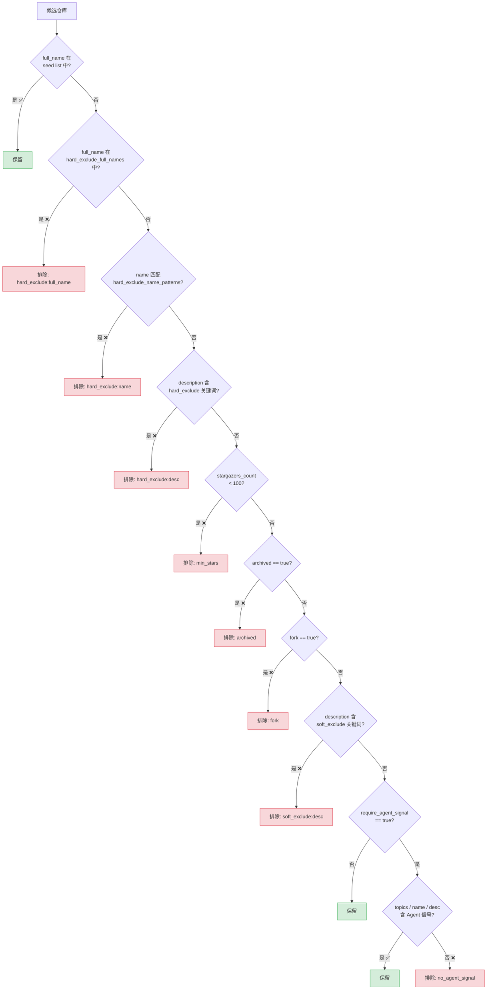
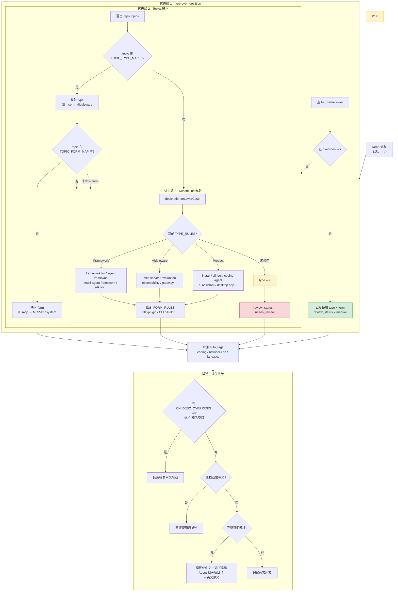
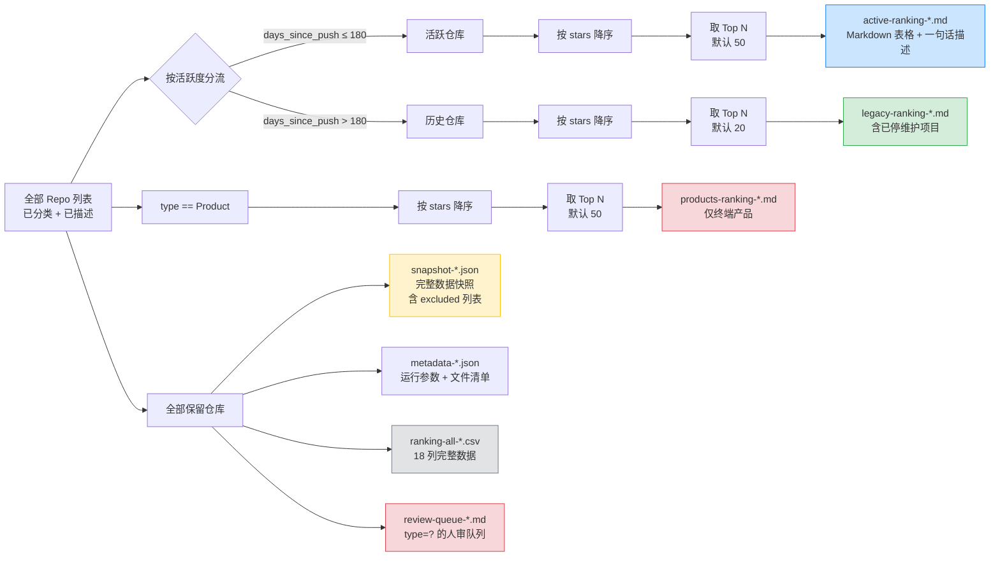
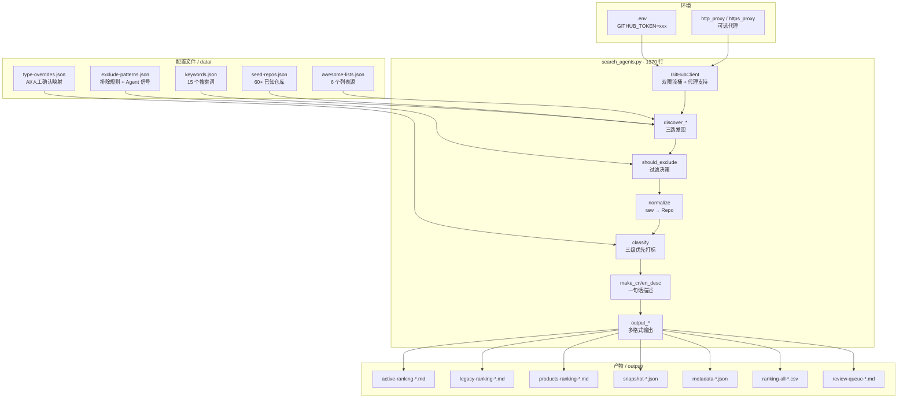
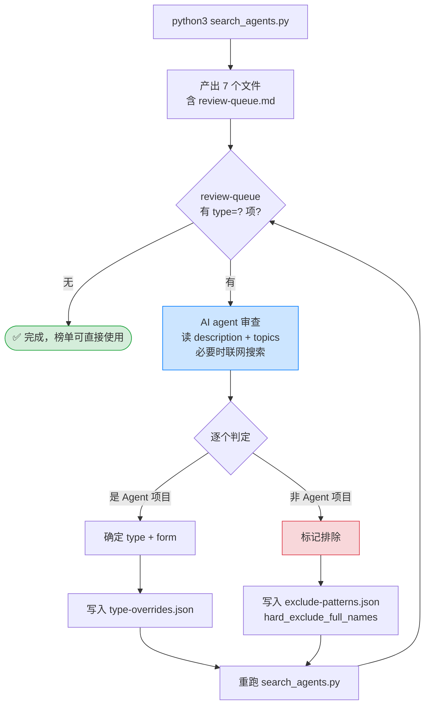

# Agent Repo Ranking — 流程图

> 本文档使用 Mermaid 语法绘制，GitHub 原生渲染。共 6 张图，覆盖从启动到输出的完整流程。

---

## 1. 全局流程总览

```mermaid
flowchart TD
    START([python3 search_agents.py]) --> LOAD[加载配置文件<br/>keywords / seed / awesome / exclude / type-overrides]
    LOAD --> TOKEN{检测 GITHUB_TOKEN?}
    TOKEN -->|有 Token| GH_OK[初始化 GitHubClient<br/>search: 30/min, core: 5000/h]
    TOKEN -->|无 Token| GH_WARN[降级模式<br/>search: 10/min, core: 60/h<br/>⚠️ 可能跑不完]
    GH_OK --> DISCOVER
    GH_WARN --> DISCOVER

    subgraph DISCOVER [Phase 1 · 三路发现]
        direction TB
        A[路径 A · 关键词搜索<br/>15 个关键词 × 每词 300 条]
        B[路径 B · Seed list<br/>60+ 已知仓库强制收录]
        C[路径 C · Awesome 列表<br/>6 个列表 README 抽取 URL]
    end

    DISCOVER --> MERGE[合并去重<br/>记录 discovery_source]
    MERGE --> FILTER

    subgraph FILTER [Phase 2 · 过滤排除]
        direction TB
        F1{在 Seed list 中?}
        F1 -->|是| KEEP1[强制保留]
        F1 -->|否| F2{命中 hard_exclude?<br/>名称模式 / 描述关键词 / 全名黑名单}
        F2 -->|是| EXCLUDE[排除]
        F2 -->|否| F3{stars < 100?}
        F3 -->|是| EXCLUDE
        F3 -->|否| F4{archived?}
        F4 -->|是| EXCLUDE
        F4 -->|否| F5{fork?}
        F5 -->|是| EXCLUDE
        F5 -->|否| F6{命中 soft_exclude?<br/>描述含不相关关键词}
        F6 -->|是| EXCLUDE
        F6 -->|否| F7{有 Agent 信号?<br/>topics / 名称 / 描述}
        F7 -->|否| EXCLUDE
        F7 -->|是| KEEP2[保留]
    end

    FILTER --> NORM[Phase 3 · 归一化<br/>raw dict → Repo 对象]
    NORM --> CLASSIFY

    subgraph CLASSIFY [Phase 3 · 分类打标]
        direction TB
        C1{命中 type-overrides.json?}
        C1 -->|是| C1A[使用人工/AI 确认的类型]
        C1 -->|否| C2{topics 匹配<br/>TOPIC_TYPE_MAP?}
        C2 -->|命中| C2A[使用 topics 映射类型]
        C2 -->|未命中| C3[description 关键词规则<br/>TYPE_RULES 匹配]
        C3 --> C3A{匹配到?}
        C3A -->|是| C3B[使用规则类型]
        C3A -->|否| C4[type = ? 需人审]
    end

    CLASSIFY --> DESC[生成一句话描述<br/>CN_DESC_OVERRIDES → 模板化 → 英文原文]
    DESC --> OUTPUT

    subgraph OUTPUT [Phase 4 · 输出]
        direction LR
        O1[活跃榜 Top N<br/>Active .md]
        O2[历史榜 Top N<br/>Legacy .md]
        O3[产品榜 Top N<br/>Products .md]
        O4[snapshot.json]
        O5[metadata.json]
        O6[ranking-all.csv]
        O7[review-queue.md]
    end

    OUTPUT --> DONE([✅ 完成])
```



---

## 2. Phase 1 · 三路发现机制

```mermaid
flowchart LR
    subgraph PathA [路径 A · 关键词搜索]
        direction TB
        A1[读取 keywords.json<br/>15 个关键词] --> A2[逐个调用<br/>GitHub Search API]
        A2 --> A3[每词取前 300 条<br/>分页 100/页]
        A3 --> A4[去重合并<br/>记录 source: keyword:xxx]
    end

    subgraph PathB [路径 B · Seed List]
        direction TB
        B1[读取 seed-repos.json<br/>60+ 已知仓库] --> B2[逐个调用<br/>GET /repos/{owner}/{name}]
        B2 --> B3[获取完整元数据<br/>记录 source: seed-list]
    end

    subgraph PathC [路径 C · Awesome 列表]
        direction TB
        C1[读取 awesome-lists.json<br/>6 个列表源] --> C2[逐个获取<br/>README 原始内容]
        C2 --> C3[正则提取<br/>github.com/owner/name]
        C3 --> C4[过滤非仓库路径<br/>features / sponsors / orgs ...]
        C4 --> C5[新 URL 补拉元数据<br/>已有则仅追加 source]
    end

    PathA --> MERGE[合并候选池<br/>dict full_name → raw data]
    PathB --> MERGE
    PathC --> MERGE

    MERGE --> POOL[候选池<br/>200~500 个仓库]
```

---

## 3. Phase 2 · 过滤排除决策树



---

## 4. Phase 3 · 分类打标优先级



---

## 5. Phase 4 · 输出文件生成



---

## 6. 数据流转：配置文件 → 处理 → 产物



---

## 7. AI 自动审查流程（取代人审）

> `search_agents.py` 保持零依赖不动。跑批后由 AI agent 读取 review-queue，
> 分类后写回 `type-overrides.json`（收录）和 `exclude-patterns.json`（排除），重跑即生效。



### 审查判定规则

| 信号 | 判定方向 | 示例 |
|---|---|---|
| description 含 framework / sdk / library | → Framework | "A programming framework for agentic AI" |
| description 含 install / app / assistant / agent | → Product | "AI pair programming in your terminal" |
| description 含 mcp / memory / observability / sandbox | → Middleware | "Universal memory layer for AI Agents" |
| topics 含 multi-agent | form = Multi-Agent-Framework | crewAI, AutoGen |
| topics 含 vscode-extension / cli | form = IDE-plugin / CLI | cline, aider |
| 仓库本身是教程 / 指南 / 泄露集 | → 排除 | claude-code-best-practice, system_prompts_leaks |
| 仓库不是 Agent 生态项目 | → 排除 | tldraw (canvas SDK), huginn (web monitor) |

### 迭代特性

首次跑批后 review-queue 可能有 30-50 项；AI 审查写入 overrides 后重跑，
queue 通常降到 0-5 项（新发现的仓库）。随着 overrides 积累，后续跑批的
queue 会越来越少，趋近于只有真正新出现的仓库。

---

## 附：关键参数速查

| 参数 | 默认值 | 说明 |
|---|---|---|
| `--top` | 50 | 活跃榜 / 产品榜取多少项 |
| `--legacy` | 20 | 历史榜取多少项 |
| `--lang` | bilingual | 输出语言：zh / en / bilingual |
| `--output-dir` | `./output/` | 输出目录 |
| `--data-dir` | `./data/` | 配置文件目录 |
| `--quiet` | false | 减少日志输出 |
| `MAX_PER_KEYWORD` | 300 | 每个关键词最多抓多少条 |
| `ACTIVE_DAYS_THRESHOLD` | 180 | 活跃 / 历史分界线（天） |
| `min_stars` | 100 | 最低 star 门槛 |
| Search API 限流 | 30/min (有 Token) | 10/min (无 Token) |
| Core API 限流 | 5000/hour (有 Token) | 60/hour (无 Token) |
